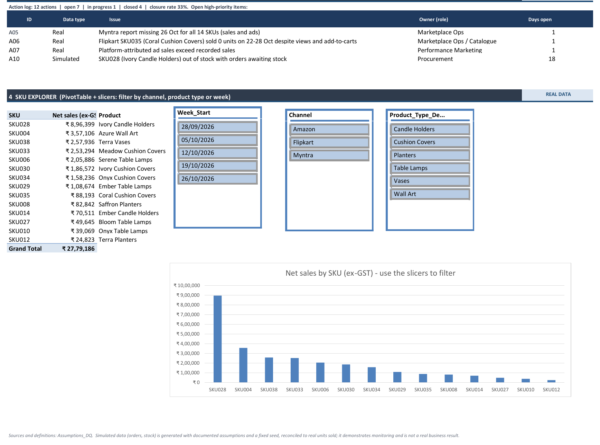
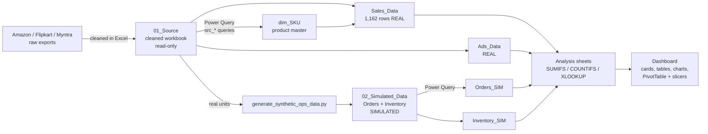

# E-commerce Marketplace Operations Tracker

**A self-initiated marketplace operations reporting and monitoring project, built in Excel 2021 desktop.**

A home-decor seller lists 14 SKUs on **Amazon, Flipkart and Myntra**. Each marketplace reports in its own format, so there is no single, reliable view of how the business is running. This tracker turns three inconsistent marketplace exports into one weekly operations review. It answers the questions an operations or marketplace manager asks every week:

- Which channels and products are driving sales, and which are falling behind?
- Is advertising spend efficient relative to total sales?
- Are orders leaving the warehouse within the agreed SLA, and what is stuck?
- Which SKUs are close to running out of stock?
- Which issues are open, who owns them, and how long have they been open?

`Excel 2021 desktop` · `Power Query` · `PivotTables, PivotCharts & slicers` · `SUMIFS / COUNTIFS / XLOOKUP / FILTER` · `Conditional formatting` · `Python (test-data generation and validation)`


> **Real vs simulated.** Sales, traffic and advertising figures are **real** marketplace data for 1 to 28 October 2026. Order, dispatch and stock data was not available, so this layer is **simulated test data**. It reconciles exactly to the real units sold and is labelled SIMULATED throughout the workbook. Simulated results demonstrate how the tracker monitors operations; they are not real business performance.

---

## Contents

1. [The business problem](#1-the-business-problem)
2. [Questions the tracker answers](#2-questions-the-tracker-answers)
3. [Repository structure](#3-repository-structure)
4. [Walkthrough: how the workbook supports a weekly review](#4-walkthrough-how-the-workbook-supports-a-weekly-review)
5. [Data pipeline](#5-data-pipeline)
6. [Data preparation and quality](#6-data-preparation-and-quality)
7. [KPI definitions](#7-kpi-definitions)
8. [Simulated data: method and reconciliation](#8-simulated-data-method-and-reconciliation)
9. [Key findings](#9-key-findings)
10. [How to open and refresh](#10-how-to-open-and-refresh)
11. [Limitations](#11-limitations)

---

## 1. The business problem

The three marketplace reports cannot be compared directly:

- **Product IDs differ:** ASIN on Amazon, SKU code on Flipkart, style ID on Myntra.
- **Formats differ:** dates are mixed, and some numbers are stored as text.
- **GST is treated differently:** Amazon and Flipkart report sales including 12% GST; Myntra reports at MRP.
- **Traffic is measured differently:** clicks, product page views and PDP views are not the same thing.

Without a common structure, simple questions such as "which channel is doing best?" give misleading answers. The goal was a single, reconciled weekly view that separates real performance from data problems, and that turns issues into owned actions rather than one-off observations.

## 2. Questions the tracker answers

| # | Business question | Main KPI | Where | Data |
| --- | --- | --- | --- | --- |
| 1 | Which marketplace performs better on sales? | Net sales, share, average daily net sales | Dashboard 1, `Sales_Performance` | Real |
| 2 | Which SKUs perform well or poorly? | SKU net sales, contribution %, rank, zero-sale days | Dashboard 1 and 4, `Sales_Performance` | Real |
| 3 | How are traffic and conversion changing? | Weekly average daily sales, weekly unit conversion | Dashboard chart, `Sales_Performance` | Real |
| 4 | How efficiently does ad spend generate revenue? | **TACoS** (main), platform ROAS (with caveat) | Dashboard 1, `Sales_Performance` | Real |
| 5 | What share of orders is dispatched within SLA? | Dispatch SLA % by warehouse and channel | Dashboard 2, `Orders_Fulfilment` | Simulated |
| 6 | How many orders are pending? | Pending orders, units, age buckets | Dashboard 2, `Orders_Fulfilment` | Simulated |
| 7 | Which SKUs have inventory risk? | Days of cover, reorder point, open PO, status | Dashboard 2, `Inventory` | Simulated stock, real demand |
| 8 | What needs attention and follow-up? | Action log: owner, priority, days open, closure rate | Dashboard 3, `Action_Log` | Real + simulated |

## 3. Repository structure

```
.
├── Marketplace_Operations_Tracker.xlsx      <- the tracker (open this)
├── 01_Source/
│   └── Source_Marketplace_Data_Cleaned.xlsx <- REAL data: raw + cleaned sheets, SKU master, ads (kept read-only)
├── 02_Simulated_Data/
│   ├── Synthetic_Ops_Data_SIMULATED.xlsx    <- SIMULATED orders, stock ledger, stock policy, assumptions
│   ├── generate_synthetic_ops_data.py       <- how the test data was generated (fixed seed, reproducible)
│   └── validate_synthetic_data.py           <- 12 checks that the test data obeys the agreed rules
└── docs/
    ├── case_study.md                        <- one-page project case study
    ├── power_query/                         <- every Power Query query as readable M code
    └── images/                              <- dashboard screenshots
```

## 4. Walkthrough: how the workbook supports a weekly review

The six sheets follow the order of a weekly operations meeting: **see the headline, drill into the area that needs attention, record the action, and check the numbers can be trusted.**

| Sheet | Role in the review | Data |
| --- | --- | --- |
| **Dashboard** | One-page summary to read in under a minute | Real + simulated, clearly keyed |
| **Sales_Performance** | Why sales and ad efficiency look the way they do | Real |
| **Orders_Fulfilment** | Where dispatch is slow and which orders are stuck | Simulated |
| **Inventory** | Which SKUs need restocking, and whether a PO is already open | Simulated stock, real demand |
| **Action_Log** | What was found, who owns it, and whether it is closed | Real + simulated |
| **Assumptions_DQ** | Report parameters, data-quality notes and live reconciliation checks | Method |

### Dashboard: the one-page review

The header shows the "as at" date and a **REAL / SIMULATED** key. The page is read top to bottom:

1. **Sales performance (real).** Five KPI cards: net sales ex-GST, units, average daily net sales, **TACoS** and platform ROAS (labelled as overstated). Below them are a channel comparison, the top 5 and bottom 3 SKUs, and a weekly trend chart. The chart uses weekly *averages*, so partial weeks and Myntra's missing day do not distort it.
2. **Fulfilment and inventory (simulated).** KPI cards for dispatch SLA against a 95% target, pending orders, oldest pending order, SKUs out of stock and return rate. Below them are a dispatch table by warehouse and channel and a "lowest days of cover" stock-risk table, both with red, amber and green flags.
3. **Actions required.** A live list of open, high-priority items from the Action Log, with owner and days open.
4. **SKU explorer.** A PivotTable and PivotChart of net sales by SKU, with slicers for **week, channel and product type**.



### Analysis sheets

Each analysis sheet keeps its summary tables on the left (columns A to R) and the Power Query data table on the right (from column T), labelled **DATA - REAL** or **DATA - SIMULATED**. This keeps every KPI traceable to its rows.

- **Sales_Performance** covers the channel summary, weekly trends, SKU ranking and contribution, and advertising efficiency by SKU and channel. Conversion is shown with each channel's traffic measure named and is compared within a channel only.
- **Orders_Fulfilment** covers headline dispatch KPIs, SLA by channel and warehouse, delay reasons, pending-order ageing and pending orders by SKU. Every SLA result is calculated against one named reporting date.
- **Inventory** shows, for each SKU at the reporting date, closing stock, backorders, recent real demand, days of cover, reorder point and open PO. A status column classifies it as `Out of stock - backorders`, `Below reorder point - PO open`, `Below reorder point - reorder now` or `OK`.

### Action_Log

The log holds 12 issues raised during the review. Each has an area, data type (Real or Simulated), evidence, priority, owner (a business role), action, status and days open. Some evidence cells are formulas, so they update with the data, for example *"Bengaluru 87.3% vs Delhi 96.7%"*. A summary shows open, in-progress and closed counts and the closure rate.

### Assumptions_DQ

This sheet makes the method visible and adjustable:

- **Report parameters** as named cells: `Report_Date` = 31 Oct 2026, `SLA_Days` = 2, `Cover_Days` = 7.
- **Nine live reconciliation checks**, each showing OK or CHECK.
- **Data sources, data-quality notes, simulated-data assumptions and KPI definitions.**

## 5. Data pipeline



- The source file is **never edited.** Every transformation is a recorded Power Query step, so it can be repeated when new exports arrive.
- `Sales_Data` **appends** the three channels into one structure. When a channel doesn't report a metric (for example, Flipkart has no impressions), the cell is left blank, never set to zero.
- Product details come from `dim_SKU` through a **left join**, so no sales row can be lost.

The full M code is in [`docs/power_query`](docs/power_query).

## 6. Data preparation and quality

| Issue found | Evidence | Treatment |
| --- | --- | --- |
| Duplicate rows in the Flipkart report | 12 exact duplicates (404 rows to 392) | Removed during cleaning; row counts reconciled |
| Mixed date formats in Flipkart | 135 dates stored as text, e.g. `01 Oct 2026` | Standardised to true dates |
| Myntra impressions stored as text | e.g. `2,322` | Converted to numbers |
| Empty rows left after duplicate removal | Power Query read 404 rows instead of 392 | Documented `Removed Blank Rows` step |
| **Myntra report missing 26 Oct** | All 14 SKUs, sales and ads | **Kept missing, not zero.** Channels are compared on average daily sales |
| SKU master categories wrong | Category does not match product name for 10 of 14 SKUs | Original kept; `Product_Type_Derived` taken from the name |
| Different GST basis | Amazon/Flipkart = MRP + 12%; Myntra = MRP | Amazon and Flipkart ÷ 1.12, so all channels are ex-GST |
| Different traffic definitions | Clicks, page views, PDP views | Conversion compared within a channel only |
| **Ad sales exceed recorded sales** | 339 of 498 ad rows | Platform ROAS shown with a caveat; TACoS is the main KPI |
| Impressions = 0 with clicks > 0 | 2 Amazon rows | Kept as reported; logged |
| Flipkart SKU035 sold nothing for 7 days | 22 to 28 Oct, despite views and add-to-carts | Logged for investigation; cause unknown |

**Reconciliation.** The 1,162 rows, 4,486 units and ₹27,79,185.93 of net sales in `Sales_Data` match the source exactly. Values are not rounded inside the data. As a separate check, 169 KPI values in the workbook were recalculated outside Excel, and all of them matched.

## 7. KPI definitions

| KPI | Calculation | Denominator | Data |
| --- | --- | --- | --- |
| Net sales (ex-GST) | Sum of `Net_Sales_exGST` | - | Real |
| Average daily net sales | Net sales ÷ days with data | Days with data for that channel (Myntra 27) | Real |
| Channel share / SKU contribution | Net sales ÷ total net sales | Total net sales | Real |
| Add-to-cart rate | Add to cart ÷ traffic | Channel traffic (definition differs) | Real |
| Unit conversion | Units ÷ traffic | Channel traffic (definition differs) | Real |
| Platform ROAS | Platform-attributed ad sales ÷ ad spend | Ad spend | Real, attribution caveat |
| **TACoS** | Ad spend ÷ total net sales of the 6 advertised SKUs | Net sales of advertised SKUs | Real; efficiency, not incrementality |
| Dispatch SLA % | Dispatched within 2 days ÷ recorded orders due by the reporting date | Non-cancelled orders due by 31 Oct; pending past due = breach | Simulated |
| Pending orders | Recorded orders with no dispatch date | - | Simulated |
| Cancellation rate | Cancelled ÷ (recorded + cancelled) | All orders placed | Simulated |
| Return rate | Returned units ÷ delivered units | Delivered units | Simulated |
| Days of cover | Closing stock ÷ average daily units ordered (22 to 28 Oct) | Real demand, last 7 days | Simulated stock |
| Action closure rate | Closed actions ÷ all actions | All logged actions | Log |

## 8. Simulated data: method and reconciliation

The simulated layer exists to test whether the tracker can catch late dispatch, backlogs and stock-outs. Its rules were agreed before any data was generated:

1. **Recorded orders add up exactly to real units** for every Date × Channel × SKU. Order value = quantity × the real ex-GST unit price.
2. **Cancelled test orders are separate rows.** They are excluded from recorded sales and from stock.
3. **Returns are measured in units,** not orders.
4. **Closing stock = opening stock + received − units fulfilled** (dispatched, not ordered). A backorder reduces stock only when it ships, and stock never goes negative.
5. **Backorders wait for the next restock** and are dispatched first-in-first-out.
6. **Myntra's missing 26 Oct stays missing.** No orders are invented for it.
7. **The reporting date is 31 Oct and the SLA is 2 days.** Orders still pending after their due date count as breaches.

Assumptions such as warehouse split, processing and transit times, cancellation and return rates, reorder rule, lead time and a **documented supplier-delay scenario** are listed on the `Assumptions_SIM` sheet and on `Assumptions_DQ`.

Run the checks yourself:

```bash
pip install pandas openpyxl
python 02_Simulated_Data/validate_synthetic_data.py          # 12 checks, all PASS
python 02_Simulated_Data/generate_synthetic_ops_data.py 01_Source/Source_Marketplace_Data_Cleaned.xlsx out.xlsx   # reproduces the file exactly
```

## 9. Key findings

### From the real marketplace data

| Finding | Evidence | What a manager should look into |
| --- | --- | --- |
| **Amazon is the largest channel** | 41.1% of net sales (₹40,767 a day); Flipkart 33.7%; Myntra 25.3% on 27 days of data. Total ₹27.8 lakh | Channel mix is fairly balanced, so a problem on any one channel has a material effect. Compare channels on daily averages, not totals, while Myntra's data has a gap |
| **Sales depend heavily on one product** | Ivory Candle Holders make up 32.3% of net sales; the bottom SKU, Terra Planters, makes 0.9% | Stock and listing health for the top SKU deserve the closest monitoring. Low performers need review before more spend goes into them |
| **Ad platforms credit more sales than were recorded** | See *Reading the advertising figures* below | Judge ad efficiency on TACoS, and treat platform ROAS as an indicator, not a revenue figure |
| **Myntra spends the most on ads relative to sales** | TACoS 43.9% on Myntra vs 33.6% overall | Review Myntra ad spend by SKU, and check whether it is supporting sales or only adding cost |
| **Some issues are data or listing problems, not demand** | Myntra's 26 Oct report is missing; Flipkart's Coral Cushion Covers recorded zero sales for 7 days despite views and add-to-carts; 10 SKU categories are wrong in the master file | Request the missing report. Check the Flipkart listing (price, stock status, buy box) for the zero-sales run. Correct the SKU master. The cause of the zero-sales run is not known from the data |

### Reading the advertising figures

Across the six advertised SKUs (1 to 28 October), ad platforms attributed **₹17.6 lakh** of sales to **₹3.8 lakh** of ad spend, a platform ROAS of **4.64x**. The marketplace reports, converted to ex-GST net sales, record **₹11.3 lakh** of sales for the same six SKUs over the same period. Platform-attributed sales are therefore about 1.56 times the recorded sales, and on 339 of 498 ad rows, attributed sales exceed the SKU's recorded sales for that day.

These two figures measure different things:

- **Platform-attributed ad sales** are each platform's own estimate of the sales its ads influenced. Platforms use attribution windows and credit rules, so a sale can be credited on a different day from when it was recorded, or credited when an ad was only one of several touchpoints.
- **Recorded net sales** are the sales actually reported in the marketplace sales exports, adjusted to a common ex-GST basis.

Because of this, **platform ROAS should not be read as verified or incremental revenue**. The gap is expected from the way attribution works, and on its own it does not show incorrect reporting by the platforms.

**TACoS (ad spend ÷ total recorded net sales of the advertised SKUs, 33.6%)** is used as the main efficiency KPI because it compares spend with sales the business actually recorded. It is still an efficiency measure, not proof that the ads caused the sales. Measuring the true incremental effect would require a controlled test, such as pausing ads for a matched set of SKUs.

### From the simulated operations layer (test data, not real results)

| What the tracker flagged | Evidence | What it demonstrates |
| --- | --- | --- |
| **Dispatch SLA below target** | 92.6% against a 95% target | The SLA cards and red/amber/green flags surface a miss straight away |
| **One warehouse is the bottleneck** | Bengaluru 87.3% vs Delhi 96.7% | Splitting SLA by warehouse points to where to look, rather than a single blended figure |
| **A stock-out is creating a backlog** | 30 orders (36 units) pending for SKU028, out of stock under the supplier-delay scenario | The inventory status, the pending-order view and the Action Log connect the stock problem to its customer impact and an owned action |

## 10. How to open and refresh

**Requirements:** Microsoft Excel 2021 desktop for Windows or later; a Microsoft 365 subscription is not required. Power Query is built into Excel 2021. Excel for the web can display the workbook but cannot refresh its Power Query connections. Python is only needed to re-run the generator or validation scripts.

1. **Download or clone the repository and keep the folder structure,** so that `01_Source` and `02_Simulated_Data` stay next to the tracker.
2. **Open `Marketplace_Operations_Tracker.xlsx`.** All tables, KPIs and charts are saved with their data, so the workbook can be reviewed without refreshing.
3. **Point the queries to your copy of the data.** The saved source paths are from the author's computer, so a refresh will fail until they are updated. Go to **Data > Get Data > Data Source Settings**, select each source workbook in the list, click **Change Source...**, browse to your copy of `01_Source/Source_Marketplace_Data_Cleaned.xlsx` or `02_Simulated_Data/Synthetic_Ops_Data_SIMULATED.xlsx`, and click **OK**. Then **Close**.
4. **Refresh** with **Data > Refresh All**.
5. **If Excel shows a warning:**
   - *Protected View* or *"External data connections have been disabled"*: click **Enable Editing** and/or **Enable Content**, but only if you trust the downloaded files.
   - *A privacy-level prompt*: set both source workbooks to the same privacy level (for example, **Organizational**) or choose to ignore privacy levels for this file, then refresh again.
   - *"Could not find file"* or a similar source error: the path in step 3 is still pointing to the original location.
6. **To see the analysis at a different date,** change `Report_Date` on `Assumptions_DQ`. SLA, pending-order and stock figures recalculate.

## 11. Limitations

- **One month of data** (28 days) with partial first and last weeks, so trends are indicative.
- **The operations layer is simulated.** It demonstrates the monitoring logic and should be replaced with real order and inventory exports.
- **TACoS measures efficiency, not incrementality.** Proving that ads caused sales would need a holdout test.
- **Simplifications in the simulation:** one stock pool per SKU, returned units not restocked, and an assumed 95% SLA target.
- **Next steps:** add more months, connect real fulfilment data, agree targets with the operations team, and publish the dashboard in Power BI if wider sharing is needed.

---

**Author:** Disha Gusain · [LinkedIn](https://www.linkedin.com/in/disha-gusain-972a00254) · B.Tech AI & ML, VIPS-TC (GGSIPU)

*Self-initiated portfolio project. Simulated data is clearly labelled and is not a real business result.*
