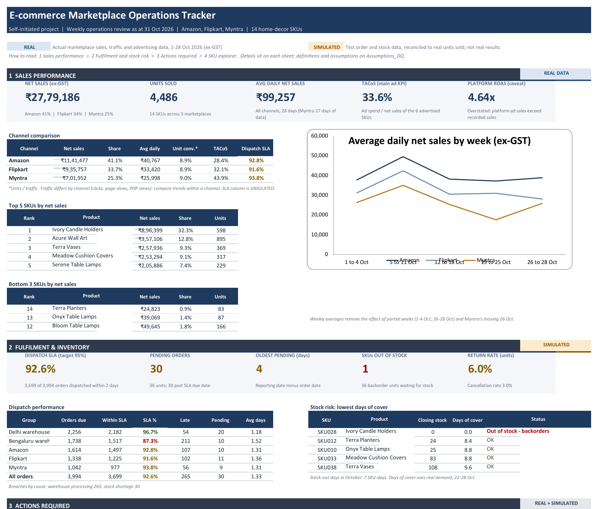
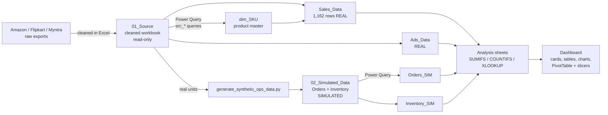

# E-commerce Marketplace Operations Tracker

**A self-initiated Excel project:** a weekly operations review for a home-decor seller with 14 SKUs on **Amazon, Flipkart and Myntra**. It covers sales, advertising efficiency, dispatch SLA, pending orders, stock risk and an action log, all on one dashboard.

`Excel 2021 / 365` · `Power Query` · `PivotTables & slicers` · `SUMIFS / COUNTIFS / XLOOKUP / FILTER` · `Conditional formatting` · `Python (test-data generator)`



> **Real vs simulated.** Sales, traffic and advertising figures are **real** marketplace data for 1 to 28 October 2026. Order, dispatch and stock data was not available, so it is **simulated test data**. It reconciles exactly to the real units sold and is labelled SIMULATED everywhere. Simulated results show how the tracker monitors operations; they are not real business results.

---

## Contents

1. [The business problem](#1-the-business-problem)
2. [Questions the tracker answers](#2-questions-the-tracker-answers)
3. [Repository structure](#3-repository-structure)
4. [Walkthrough: how to read the workbook](#4-walkthrough-how-to-read-the-workbook)
5. [Data pipeline](#5-data-pipeline)
6. [Data preparation and quality](#6-data-preparation-and-quality)
7. [KPI definitions](#7-kpi-definitions)
8. [Simulated data: method and reconciliation](#8-simulated-data-method-and-reconciliation)
9. [Key findings](#9-key-findings)
10. [How to open and refresh](#10-how-to-open-and-refresh)
11. [Limitations](#11-limitations)

---

## 1. The business problem

Each marketplace exports its own report, and the three reports don't line up: product IDs differ (ASIN, Flipkart SKU code, Myntra style ID), date formats are mixed, GST is treated differently and traffic is measured differently. An operations team needs a single, trustworthy weekly view:

- How is each channel and SKU selling?
- Is advertising spend efficient?
- Are orders being dispatched on time, and what is stuck?
- Which SKUs are about to run out of stock?
- Which issues are open, who owns them, and for how long?

## 2. Questions the tracker answers

| # | Business question | Main KPI | Where | Data |
| --- | --- | --- | --- | --- |
| 1 | Which marketplace performs better on sales? | Net sales, share, average daily net sales | Dashboard 1, `Sales_Performance` | Real |
| 2 | Which SKUs perform well or poorly? | SKU net sales, contribution %, rank, zero-sale days | Dashboard 1 and 4, `Sales_Performance` | Real |
| 3 | How are traffic and conversion changing? | Weekly average daily sales, weekly unit conversion | Dashboard chart, `Sales_Performance` | Real |
| 4 | How efficiently does ad spend generate revenue? | **TACoS** (main), platform ROAS (with caveat) | Dashboard 1, `Sales_Performance` | Real |
| 5 | What share of orders is dispatched within SLA? | Dispatch SLA % by warehouse and channel | Dashboard 2, `Orders_Fulfilment` | Simulated |
| 6 | How many orders are pending? | Pending orders, units, age buckets | Dashboard 2, `Orders_Fulfilment` | Simulated |
| 7 | Which SKUs have inventory risk? | Days of cover, reorder point, open PO, status | Dashboard 2, `Inventory` | Simulated stock, real demand |
| 8 | What needs attention and follow-up? | Action log: owner, priority, days open, closure rate | Dashboard 3, `Action_Log` | Real + simulated |

## 3. Repository structure

```
.
├── Marketplace_Operations_Tracker.xlsx      <- the tracker (open this)
├── 01_Source/
│   └── Source_Marketplace_Data_Cleaned.xlsx <- REAL data: raw + cleaned sheets, SKU master, ads (kept read-only)
├── 02_Simulated_Data/
│   ├── Synthetic_Ops_Data_SIMULATED.xlsx    <- SIMULATED orders, stock ledger, stock policy, assumptions
│   ├── generate_synthetic_ops_data.py       <- how the test data was generated (fixed seed, reproducible)
│   └── validate_synthetic_data.py           <- 12 checks that the test data obeys the agreed rules
└── docs/
    ├── case_study.md                        <- one-page project case study
    ├── power_query/                         <- every Power Query query as readable M code
    └── images/                              <- dashboard screenshots
```

## 4. Walkthrough: how to read the workbook

The workbook has six sheets, which follow the order of a weekly review.

### Dashboard: the one-page review

The dashboard is meant to be read in under a minute, top to bottom. The header carries the "as at" date and a **REAL / SIMULATED** key.

**Section 1: Sales performance (real).** It opens with five KPI cards: net sales ex-GST, units, average daily net sales, **TACoS** and platform ROAS. ROAS is labelled overstated. Below the cards are a channel comparison table, the top 5 and bottom 3 SKUs, and a weekly line chart. The chart uses weekly *averages*, which removes the effect of partial weeks and of Myntra's missing day.

**Section 2: Fulfilment and inventory (simulated).** KPI cards show dispatch SLA against a 95% target, pending orders, the oldest pending order, SKUs out of stock and return rate. Below them are a dispatch table by warehouse and channel, and a "lowest days of cover" stock-risk table. Both use red, amber and green flags.

**Section 3: Actions required.** A live `FILTER` list of open, high-priority actions from the Action Log, with owner and days open.

**Section 4: SKU explorer.** A PivotTable and PivotChart of net sales by SKU, with slicers for **week, channel and product type**.


### Sales_Performance (real)

Each analysis sheet keeps its summary in columns A to R and its data table, loaded by Power Query, from column T. The table is labelled **DATA - REAL** or **DATA - SIMULATED**. This sheet holds:

1. **Channel summary:** days with data, units, net sales, average daily sales, share, add-to-cart rate and unit conversion. Each channel's traffic measure is named, because the three definitions differ.
2. **Weekly average daily net sales** by channel.
3. **Weekly unit conversion** by channel, compared within each channel only.
4. **SKU performance:** net sales by channel, contribution %, rank, units and zero-sale days.
5. **Advertising efficiency** by SKU and by channel: ad spend, platform ad sales, ROAS, **TACoS**, and platform ad sales ÷ net sales.

### Orders_Fulfilment (simulated)

- **Headline KPIs:** recorded orders, orders due, dispatched within SLA, SLA %, late dispatches, breaches still pending, average days to dispatch, pending orders and units, oldest pending order, cancellation rate and return rate.
- **SLA by channel and by warehouse,** then **delay reasons** and **pending-order ageing,** then **pending orders by SKU.**
- Three helper columns sit beside the order table: `Days_to_Dispatch`, `SLA_Result` and `Pending_Age_Days`. All of them use one named cell, `Report_Date`.

### Inventory (simulated stock, real demand)

For each SKU at the reporting date, the sheet shows closing stock, backorder units, average daily units ordered (last 7 days of real sales), **days of cover**, reorder point, open PO quantity and stock-out days. The status column reads:
`Out of stock - backorders` / `Below reorder point - PO open` / `Below reorder point - reorder now` / `OK`.

### Action_Log

The log has 12 issues found during the review. Each row has an ID, the date raised, area, data type (Real or Simulated), evidence, priority, owner (a business role), action, status, date closed and days open. Some evidence cells are formulas, so they update with the data, for example *"Bengaluru 87.3% vs Delhi 96.7%"*. A summary at the top shows open, in-progress and closed counts and the closure rate.

### Assumptions_DQ

This sheet documents the method:

- **Report parameters,** as named cells: `Report_Date` = 31 Oct 2026, `SLA_Days` = 2 and `Cover_Days` = 7.
- **Data sources.**
- **Nine live reconciliation checks,** each showing OK or CHECK.
- **Data-quality notes,** every simulated-data assumption, and a **KPI definitions** table.

## 5. Data pipeline



- The source file is **never edited.** Every transformation is a recorded Power Query step, so it can be repeated when new exports arrive.
- `Sales_Data` **appends** the three channels into one structure. When a channel doesn't report a metric (for example, Flipkart has no impressions), the cell is left blank, never set to zero.
- Product details come from `dim_SKU` through a **left join**, so no sales row can be lost.

The full M code is in [`docs/power_query`](docs/power_query).

## 6. Data preparation and quality

| Issue found | Evidence | Treatment |
| --- | --- | --- |
| Duplicate rows in the Flipkart report | 12 exact duplicates (404 rows to 392) | Removed during cleaning; row counts reconciled |
| Mixed date formats in Flipkart | 135 dates stored as text, e.g. `01 Oct 2026` | Standardised to true dates |
| Myntra impressions stored as text | e.g. `2,322` | Converted to numbers |
| Empty rows left after duplicate removal | Power Query read 404 rows instead of 392 | Documented `Removed Blank Rows` step |
| **Myntra report missing 26 Oct** | All 14 SKUs, sales and ads | **Kept missing, not zero.** Channels are compared on average daily sales |
| SKU master categories wrong | Category does not match product name for 10 of 14 SKUs | Original kept; `Product_Type_Derived` taken from the name |
| Different GST basis | Amazon/Flipkart = MRP + 12%; Myntra = MRP | Amazon and Flipkart ÷ 1.12, so all channels are ex-GST |
| Different traffic definitions | Clicks, page views, PDP views | Conversion compared within a channel only |
| **Ad sales exceed recorded sales** | 339 of 498 ad rows | Platform ROAS shown with a caveat; TACoS is the main KPI |
| Impressions = 0 with clicks > 0 | 2 Amazon rows | Kept as reported; logged |
| Flipkart SKU035 sold nothing for 7 days | 22 to 28 Oct, despite views and add-to-carts | Logged for investigation; cause unknown |

**Reconciliation.** The 1,162 rows, 4,486 units and ₹27,79,185.93 of net sales in `Sales_Data` match the source exactly. Values are not rounded inside the data. As a separate check, 169 KPI values in the workbook were recalculated outside Excel, and all of them matched.

## 7. KPI definitions

| KPI | Calculation | Denominator | Data |
| --- | --- | --- | --- |
| Net sales (ex-GST) | Sum of `Net_Sales_exGST` | - | Real |
| Average daily net sales | Net sales ÷ days with data | Days with data for that channel (Myntra 27) | Real |
| Channel share / SKU contribution | Net sales ÷ total net sales | Total net sales | Real |
| Add-to-cart rate | Add to cart ÷ traffic | Channel traffic (definition differs) | Real |
| Unit conversion | Units ÷ traffic | Channel traffic (definition differs) | Real |
| Platform ROAS | Platform-attributed ad sales ÷ ad spend | Ad spend | Real, attribution caveat |
| **TACoS** | Ad spend ÷ total net sales of the 6 advertised SKUs | Net sales of advertised SKUs | Real; efficiency, not incrementality |
| Dispatch SLA % | Dispatched within 2 days ÷ recorded orders due by the reporting date | Non-cancelled orders due by 31 Oct; pending past due = breach | Simulated |
| Pending orders | Recorded orders with no dispatch date | - | Simulated |
| Cancellation rate | Cancelled ÷ (recorded + cancelled) | All orders placed | Simulated |
| Return rate | Returned units ÷ delivered units | Delivered units | Simulated |
| Days of cover | Closing stock ÷ average daily units ordered (22 to 28 Oct) | Real demand, last 7 days | Simulated stock |
| Action closure rate | Closed actions ÷ all actions | All logged actions | Log |

## 8. Simulated data: method and reconciliation

The simulated layer exists to test whether the tracker can catch late dispatch, backlogs and stock-outs. It follows rules that were agreed before any data was generated:

1. **Recorded orders add up exactly to real units** for every Date × Channel × SKU. Order value = quantity × the real ex-GST unit price.
2. **Cancelled test orders are separate rows.** They are excluded from recorded sales and from stock.
3. **Returns are measured in units,** not orders.
4. **Closing stock = opening stock + received − units fulfilled** (dispatched, not ordered). A backorder reduces stock only when it ships, and stock never goes negative.
5. **Backorders wait for the next restock** and are dispatched first-in-first-out.
6. **Myntra's missing 26 Oct stays missing.** No orders are invented for it.
7. **The reporting date is 31 Oct and the SLA is 2 days.** Orders still pending after their due date count as breaches.

Assumptions such as warehouse split, processing and transit times, cancellation and return rates, reorder rule, lead time and a **documented supplier-delay scenario** are listed on the `Assumptions_SIM` sheet and on `Assumptions_DQ`.

Run the checks yourself:

```bash
pip install pandas openpyxl
python 02_Simulated_Data/validate_synthetic_data.py          # 12 checks, all PASS
python 02_Simulated_Data/generate_synthetic_ops_data.py 01_Source/Source_Marketplace_Data_Cleaned.xlsx out.xlsx   # reproduces the file exactly
```

## 9. Key findings

**From the real data**

- **Amazon leads** with 41.1% of net sales (₹40,767 a day). Flipkart has 33.7% and Myntra 25.3% (27 days of data). Total net sales are ₹27.8 lakh.
- **Sales are concentrated:** Ivory Candle Holders alone make up 32.3% of net sales. Terra Planters, the bottom SKU, makes 0.9%.
- **Platform ROAS (4.64x) is overstated.** Ad platforms claim ₹17.6 lakh of ad sales, but the advertised SKUs recorded only ₹11.3 lakh of net sales. **TACoS is 33.6%** overall, and Myntra is highest at 43.9%.
- **There are data issues to chase.** Myntra's 26 Oct report is missing. Flipkart's Coral Cushion Covers had zero sales for 7 days despite traffic. SKU master categories are wrong for 10 SKUs.

**What the simulated layer demonstrates** (test data, not real results)

- Dispatch SLA is **92.6%** against a 95% target. The Bengaluru warehouse (87.3%) is the bottleneck; Delhi reaches 96.7%.
- **30 orders (36 units) are pending** for SKU028, which is out of stock because of the supplier-delay scenario. It is flagged with an open PO and an action.

## 10. How to open and refresh

1. Download or clone the repository, keeping the folder structure.
2. Open `Marketplace_Operations_Tracker.xlsx` in Excel 2021 or Microsoft 365. Everything displays without refreshing.
3. To refresh from the source files, click **Enable Content**. Then go to **Data > Get Data > Data Source Settings** and point each source to your copy of `01_Source/...` and `02_Simulated_Data/...` (the saved paths are from the author's computer). Then click **Data > Refresh All**.
4. To see the analysis at a different date, change `Report_Date` on `Assumptions_DQ`. SLA, pending orders and stock figures all recalculate.

## 11. Limitations

- **One month of data** (28 days) with partial first and last weeks, so trends are indicative.
- **The operations layer is simulated.** It demonstrates the monitoring logic and should be replaced with real order and inventory exports.
- **TACoS measures efficiency, not incrementality.** Proving that ads caused sales would need a holdout test.
- **Simplifications in the simulation:** one stock pool per SKU, returned units not restocked, and an assumed 95% SLA target.
- **Next steps:** add more months, connect real fulfilment data, agree targets with the operations team, and publish the dashboard in Power BI if wider sharing is needed.

---

**Author:** Disha Gusain · [LinkedIn](https://www.linkedin.com/in/disha-gusain-972a00254) · B.Tech AI & ML, VIPS-TC (GGSIPU)

*Self-initiated portfolio project. Simulated data is clearly labelled and is not a real business result.*
